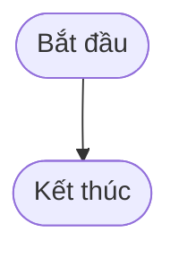

# BÁO CÁO BÀI TẬP: VIẾT ACCEPTANCE CRITERIA VÀ DEFINITION OF DONE CHO USER STORY

> 👤 **Học viên:** Đỗ Hoàng Sơn | **Mã SV:** PTIT-HCM-066
> 🏫 **Môn học:** IT206-K25-Agile-va-Scrum

---

## 📊 Sơ đồ thiết kế hệ thống (Activity Diagram)

> 💡 *Sơ đồ dưới đây được render tự động trực tiếp trên GitHub bằng Mermaid. Bạn cũng có thể tải file **`bt1.drawio`** trong repository này để mở và chỉnh sửa trực tiếp trên [Draw.io (diagrams.net)](https://app.diagrams.net).* 

---

## Nhiệm vụ 1: Viết Acceptance Criteria cho User Story 1 (Đặt mượn sách online)

User Story 1: 'Là một độc giả, tôi muốn đặt mượn online một cuốn sách đang có sẵn để tôi không mất công đến thư viện rồi mới biết sách đã có người mượn.'

Dưới đây là các Acceptance Criteria được xây dựng theo định dạng Gherkin (Given-When-Then), bao gồm luồng chính (happy path), trường hợp lỗi (negative case) và trường hợp biên (edge case):

- Câu hỏi làm rõ cho Product Owner: 'Nếu độc giả đặt mượn nhưng sau 48 giờ không đến nhận thì hệ thống tự động hoàn lại sách vào kho hay cần thủ thư thao tác thủ công? Thời gian tính 48 giờ có tính ngày nghỉ cuối tuần hay lễ tết của thư viện không?'

| Story | AC# | Loại | Given | When | Then |
| --- | --- | --- | --- | --- | --- |
| Story 1 | AC1.1 | Happy Path | Độc giả đã đăng nhập tài khoản thư viện và sách 'Lập trình C++ nâng cao' đang có sẵn ít nhất 1 bản tại thư viện | Độc giả bấm nút 'Đặt mượn ngay' | Hệ thống ghi nhận thành công đơn đặt mượn, trừ đi 1 bản sách trong kho tạm thời và hiển thị thông báo 'Đặt mượn thành công. Vui lòng đến nhận sách trước 48 giờ' kèm mã QR nhận sách. |
| Story 1 | AC1.2 | Negative Case | Độc giả đã đăng nhập và cuốn sách 'Python căn bản' hiện tại đã hết sạch bản trong kho (số lượng sẵn có bằng 0) | Độc giả xem trang chi tiết sách | Nút 'Đặt mượn ngay' bị ẩn hoặc đổi thành 'Hết sách', đồng thời hiển thị nhãn 'Tạm hết' và không cho phép tạo đơn đặt mượn. |
| Story 1 | AC1.3 | Edge Case | Độc giả đang có một đơn đặt mượn sách 'Toán cao cấp' chưa đến nhận sau thời hạn 48 giờ (đơn vẫn đang ở trạng thái chờ) | Độc giả cố gắng đặt mượn thêm một cuốn sách khác cùng tựa đề 'Toán cao cấp' | Hệ thống từ chối yêu cầu và hiển thị thông báo 'Bạn đang có đơn đặt mượn cho cuốn sách này chưa hoàn tất, không thể đặt thêm bản sao khác'. |

## Nhiệm vụ 2: Viết Acceptance Criteria cho User Story 2 (Nhận thông báo đặt chỗ)

User Story 2: 'Là một độc giả, tôi muốn nhận thông báo khi sách tôi đặt trước đã có sẵn để tôi kịp đến nhận sách trước khi hết thời gian giữ chỗ.'

Dưới đây là các Acceptance Criteria cho tính năng thông báo:

- Câu hỏi làm rõ cho Product Owner: 'Trong trường hợp độc giả ở vị trí số 1 không đến nhận trong 24 giờ đầu, hệ thống có tự động gửi thông báo cho độc giả số 2 hay cần thủ thư thao tác duyệt thủ công?'

| Story | AC# | Loại | Given | When | Then |
| --- | --- | --- | --- | --- | --- |
| Story 2 | AC2.1 | Happy Path | Độc giả đã đăng ký nhận thông báo cho cuốn sách 'Cấu trúc dữ liệu' đang hết, và hệ thống vừa có một độc giả khác trả lại sách này | Thủ thư xác nhận sách vừa được hoàn trả vào hệ thống | Hệ thống ngay lập tức gửi thông báo đẩy (push notification) qua ứng dụng và email cho độc giả với nội dung 'Sách Cấu trúc dữ liệu bạn đặt trước đã sẵn sàng. Vui lòng đến nhận trước [Thời gian hết hạn]'.x |
| Story 2 | AC2.2 | Negative Case | Độc giả đã tắt hoàn toàn quyền nhận thông báo (notification permission) trên thiết bị di động hoặc vô hiệu hóa email trong cài đặt tài khoản | Hệ thống kích hoạt sự kiện gửi thông báo sách có sẵn cho độc giả này | Hệ thống ghi nhận trạng thái gửi thất bại do cấu hình người dùng, đồng thời tự động chuyển sang đưa vào hộp thư nội bộ (inbox) trong trang quản lý cá nhân của độc giả. |
| Story 2 | AC2.3 | Edge Case | Có 3 độc giả cùng xếp hàng chờ (waiting list) cho duy nhất 1 bản sách vừa được trả về thư viện | Hệ thống kích hoạt quy trình phân bổ sách cho người đầu tiên trong hàng đợi | Hệ thống chỉ gửi thông báo giữ chỗ cho độc giả ở vị trí số 1 trong danh sách chờ, kèm thời hạn độc quyền nhận sách trong 24 giờ đầu tiên, các độc giả ở vị trí số 2 và 3 giữ nguyên trạng thái chờ. |

## Nhiệm vụ 3: Viết Acceptance Criteria cho User Story 3 (Giới hạn số sách mượn)

User Story 3: 'Là một thủ thư, tôi muốn giới hạn số sách một độc giả được mượn cùng lúc để tránh tình trạng một người giữ hết sách.'

Dưới đây là các Acceptance Criteria kết hợp ràng buộc nghiệp vụ:

- Câu hỏi làm rõ cho Product Owner: 'Hạn mức tối đa 5 cuốn/độc giả này có áp dụng chung cho tất cả các loại độc giả (sinh viên, giảng viên, nghiên cứu viên) hay cần phân quyền theo từng hạng tài khoản?'
- Giả định kỹ thuật đã thống nhất: Giới hạn mặc định tối đa là 5 cuốn/độc giả.

| Story | AC# | Loại | Given | When | Then |
| --- | --- | --- | --- | --- | --- |
| Story 3 | AC3.1 | Ràng buộc nghiệp vụ | Giả định: Quy định tối đa của thư viện là độc giả chỉ được mượn tối đa 5 cuốn sách cùng một thời điểm. Độc giả A hiện đang mượn và giữ 4 cuốn sách chưa trả | Độc giả A thao tác mượn thêm 2 cuốn sách mới | Hệ thống chặn giao dịch và hiển thị thông báo 'Bạn đã đạt giới hạn mượn tối đa 5 cuốn. Vui lòng trả sách cũ trước khi mượn thêm'. |
| Story 3 | AC3.2 | Happy Path | Độc giả B hiện đang mượn 2 cuốn sách và chưa vi phạm quy định quá hạn nào | Độc giả B gửi yêu cầu mượn thêm 1 cuốn sách mới | Hệ thống kiểm tra tổng số lượng sách đang mượn là 3 (nhỏ hơn hạn mức 5), cho phép tạo phiếu mượn sách thành công. |
| Story 3 | AC3.3 | Edge Case | Độc giả C có tài khoản bị gắn cờ cảnh cáo vi phạm nội quy thư viện (dù số lượng sách đang mượn mới chỉ có 1 cuốn) | Độc giả C cố gắng đặt mượn thêm sách trực tuyến | Hệ thống chặn yêu cầu đặt mượn dựa trên trạng thái bị phạt của tài khoản và hiển thị thông báo 'Tài khoản của bạn đang bị hạn chế giao dịch mượn sách'. |

## Definition of Done (DoD) chung cho nhóm phát triển

Definition of Done dưới đây được áp dụng chung cho mọi Product Backlog Item (áp dụng minh họa cho cả 3 User Story trên), đảm bảo tiêu chuẩn chất lượng trước khi phát hành:

- 1. Code hoàn thiện và đã vượt qua ít nhất 80% độ bao phủ kiểm thử đơn vị (unit test coverage).
- 2. Đã được ít nhất 1 thành viên khác trong nhóm code review và không còn lỗi bảo mật nghiêm trọng.
- 3. Giao diện hiển thị đúng thiết kế UI/UX trên cả trình duyệt máy tính và thiết bị di động (responsive).
- 4. Đã kiểm thử đầy đủ các Acceptance Criteria (bao gồm happy path, negative case và edge case) và không phát sinh lỗi mức độ cao (high/blocker).
- 5. Tài liệu hướng dẫn sử dụng hoặc mô tả thay đổi (Release Notes) đã được cập nhật đầy đủ trên kho lưu trữ chung.

## Đánh giá trạng thái Done của Story 1

Story 1 đã hoàn thành đầy đủ các Acceptance Criteria đã viết nhưng code chưa được review theo DoD của nhóm, thì Story 1 VẪN CHƯA được coi là Done.

Vì sao: Theo quy định trong Definition of Done của nhóm, một Product Backlog Item chỉ được nghiệm thu là Done khi thỏa mãn toàn bộ các tiêu chí đặt ra, trong đó bắt buộc phải có bước code review và kiểm thử chất lượng đầy đủ. Thiếu bước code review đồng nghĩa với việc sản phẩm chưa đạt chuẩn chất lượng cam kết của toàn đội ngũ Agile.

---

## 📁 Danh sách tệp tin nộp bài trong Repository
- 📝 `bt1.docx`: Báo cáo tài liệu phân tích nghiệp vụ hoàn chỉnh.
- 🎨 `bt1.drawio`: File thiết kế sơ đồ chuẩn theo quy định đề bài (mở trực tiếp bằng [Draw.io](https://app.diagrams.net) hoặc Lucidchart).
